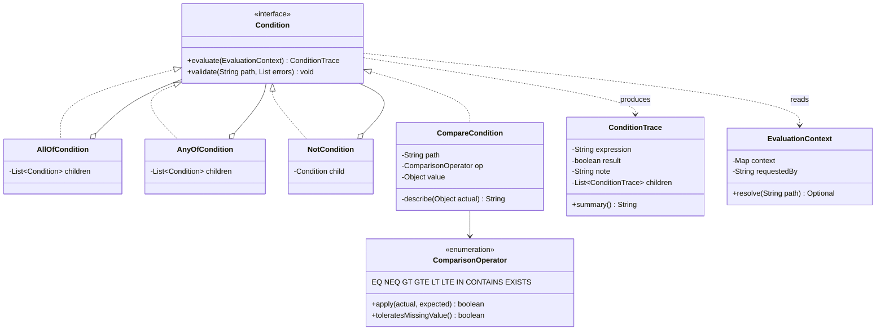
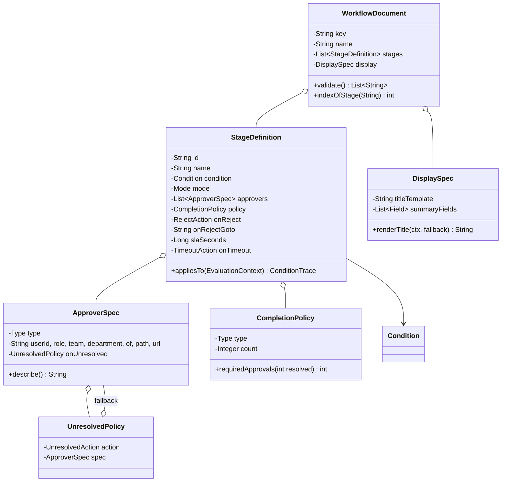
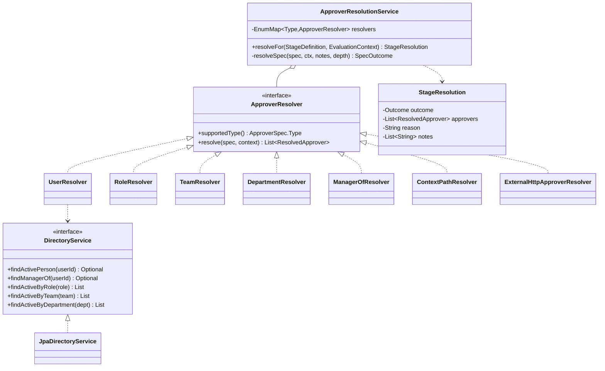
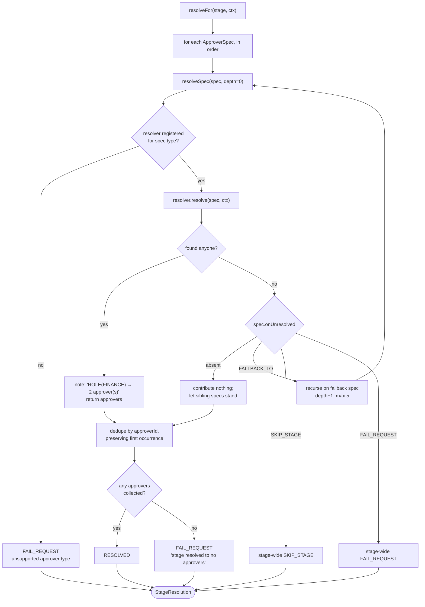
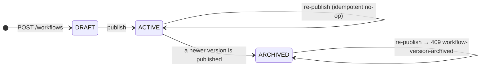
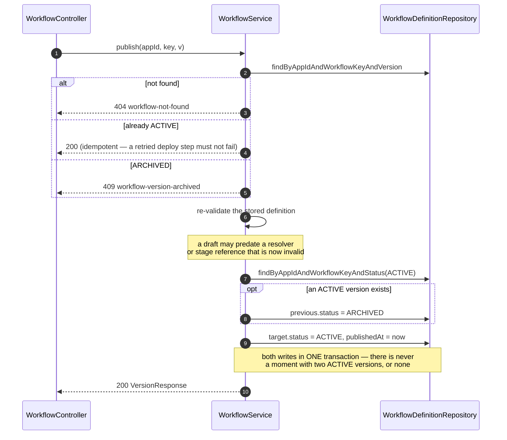
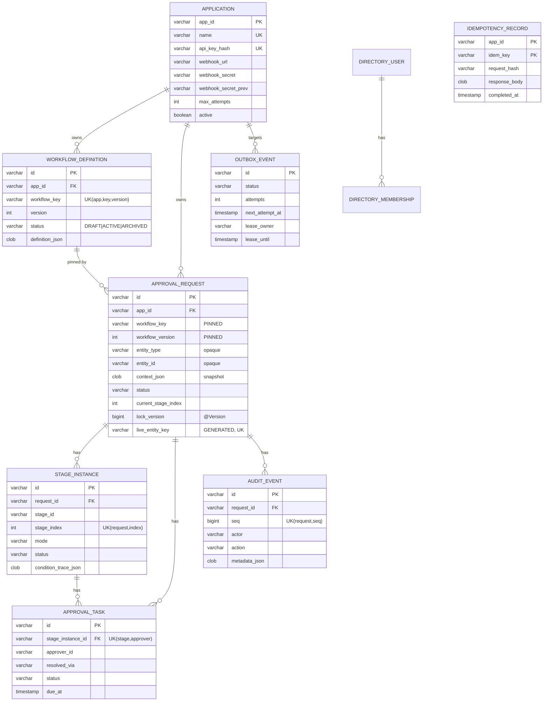
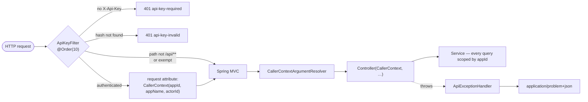

# Low-Level Design — as built

Class-level design. Companion to [API-CONTRACT.md](API-CONTRACT.md) (what the endpoints do) and
the README (why the architecture is shaped this way).

- **Runtime:** Java 8 (Corretto `1.8.0_472`), Spring Boot 2.7.18, H2 2.1.214 file mode, Flyway 8.5.13, springdoc 1.6.15
- **Source:** 102 Java files · 4 migrations · 15 entities · 15 repositories · 6 controllers
- **Verified:** boots with `ddl-auto: validate`, so every entity mapping is checked against the Flyway schema at startup

---

## 1. Build status

Everything below is implemented and exercised by `demo.sh` / `scripts/api-examples.sh`.

| Area | Notes |
|---|---|
| Condition tree, evaluator, traces | §3 |
| Workflow definition model + publish-time structural validation | §4 |
| Workflow versioning (DRAFT → ACTIVE → ARCHIVED), version pinning | §6 |
| Approver resolution SPI, 7 resolvers, fallback chains | §5 |
| **Relational approver model** (roles/teams/departments as entities) + reference validation | §5.1 |
| Directory SPI + JPA implementation, both lookup directions | §5.2 |
| Multi-tenant registration, API-key auth, caller scoping | §8 |
| `simulate` (dry-run with traces + real resolution) | §6 |
| RFC 7807 error mapping (38 error types) | §8 |
| **Workflow executor** — stage planning, activation, advancement, attempts | §9 |
| **Action service** — conditional claim, row lock, completion re-count | §10 |
| **Entitlement re-check at action time** | §5.3 |
| **Idempotency** — claim / replay / release | §11 |
| **Outbox dispatcher** — lease claim, HMAC, backoff, dead-letter, replay | §12 |
| **Startup recovery** and **SLA sweeper** | §13 |
| Engine-hosted cross-application inbox with `display` rendering | §14 |
| Append-only audit, totally ordered per request | §9.4 |

No automated test suite — a deliberate scope decision, discussed in the README.

## 2. Package map

```
com.approvalengine
├── ApprovalEngineApplication          @SpringBootApplication @EnableScheduling
│
├── config/
│   ├── ApprovalProperties             outbox · sla · recovery · concurrency tunables
│   └── HttpClientConfig               approvalRestTemplate (mandatory timeouts)
│
├── domain/                            ← no Spring, no JPA, no HTTP
│   ├── Ids                            prefixed time-ordered id generation
│   ├── workflow/
│   │   ├── WorkflowDocument · StageDefinition · ApproverSpec
│   │   ├── CompletionPolicy · DisplaySpec · WorkflowStatus
│   │   └── condition/                 Condition + 4 nodes · ComparisonOperator
│   │                                  ConditionTrace · EvaluationContext
│   ├── request/
│   │   ├── RequestStatus · StageStatus · TaskStatus · AuditAction
│   │   ├── StateMachine               the only legal-transition authority
│   │   └── IllegalStateTransitionException
│   ├── notify/                        OutboxStatus · EventType
│   └── directory/                     DirectoryService (SPI) · DirectoryPerson
│
├── application/                       ← orchestration; transaction boundaries live here
│   ├── JsonCodec · Hashing
│   ├── WorkflowService                createDraft · publish · parse · simulate
│   ├── WorkflowReferenceValidator     publish-time reference checks + rule projection
│   ├── RequestService                 create · resubmit · cancel · reassign
│   ├── RequestQueryService            read models
│   ├── ActionService                  approve / reject / request-changes  ◀ concurrency
│   ├── ApproverEligibilityService     entitlement re-check at action time
│   ├── IdempotencyService             claim · complete · release
│   ├── WorkflowExecutor               ◀ the heart
│   ├── ExecutionContext               request + application + pinned definition + context
│   ├── AuditWriter                    append-only, in-transaction
│   ├── InboxService                   cross-application queue + display rendering
│   ├── ApplicationRegistrationService register · rotateWebhookSecret
│   ├── notify/
│   │   ├── OutboxWriter               enqueue in the same transaction as the decision
│   │   ├── OutboxDispatcher           @Scheduled lease claim · backoff · dead-letter
│   │   └── WebhookSender              HMAC-signed POST, never throws
│   └── resolver/
│       ├── ApproverResolver (SPI) · DirectoryApproverResolvers (6)
│       ├── ExternalHttpApproverResolver
│       ├── ApproverResolutionService  fallback chains + dedupe
│       └── ResolvedApprover · StageResolution
│
├── ops/
│   ├── StartupRecoveryService         @EventListener(ApplicationReadyEvent)
│   └── SlaSweeper                     @Scheduled
│
├── adapter/
│   ├── persistence/entity/            15 JPA entities
│   ├── persistence/repository/        15 Spring Data repositories
│   ├── directory/JpaDirectoryService  DirectoryService implementation
│   └── web/
│       ├── ApiKeyFilter · CallerContext · CallerContextArgumentResolver
│       ├── ApiExceptionHandler        → application/problem+json
│       ├── AdminApplicationController · AdminDirectoryController · AdminOpsController
│       ├── WorkflowController · RequestController · InboxController
│       └── dto/RequestViews
│
└── error/
    EngineException → NotFound(404) · Conflict(409) · Validation(422)
                    · Unauthorized(401) · Forbidden(403) · EligibilityRefused(403)
```

**Dependency rule:** `domain` depends on nothing but Jackson annotations and the JDK.
`application` depends on `domain`. `adapter` depends on both. Nothing points inward from
`adapter` to `adapter`. This is why the condition tree and state machine are testable and
reusable without a Spring context, and why swapping H2 for Postgres or the local directory
for a real HRMS touches one package.

---

## 3. Condition tree



Jackson dispatches on `"type"` via `@JsonTypeInfo` + `@JsonSubTypes`
(`allOf` / `anyOf` / `not` / `compare`). An unknown discriminator fails deserialization and
surfaces as `400 malformed-json` with the cause attached.

### Design properties, and why each one is load-bearing

| Property | Why |
|---|---|
| **Closed node set** | A definition is data uploaded by a consumer. With SpEL or any expression language, evaluating a rule could execute arbitrary code — and could not be explained node by node. |
| **Nodes self-evaluate** | `Condition.evaluate` returns a trace directly. No visitor, no separate interpreter that could drift from the model. |
| **Evaluation is total** | Every operator returns true/false for any input pair and never throws. A malformed context can't abort a request mid-approval. |
| **No short-circuiting** | `AllOfCondition` evaluates every child even after one is false. Costs a negligible amount of work; buys a complete trace, so an auditor sees the outcome of each clause rather than only the first failure. |
| **Validation is separate from evaluation** | `validate()` runs at publish, accumulating *all* errors into a list rather than throwing on the first. |

### Operator semantics

`ComparisonOperator.apply(actual, expected)`:

1. If `actual == null` (path absent) and the operator is not `EXISTS`/`NEQ` → **false**.
2. `compareOrNull` attempts a three-way compare:
   - both sides numeric-coercible → `BigDecimal.compareTo`. This is why `25000` and `"25000"` compare equal — JSON hands us Integer, Long, Double and String inconsistently for the same business value.
   - either side Boolean, Collection or Map → `null` (not ordered).
   - otherwise → `String.compareTo`.
3. `null` from step 2 means "not ordered": `GT/GTE/LT/LTE` → false; `EQ` falls back to string equality.
4. `EQ` handles null explicitly first, so an absent path never equals the literal string `"null"`.

| Operator | Behaviour |
|---|---|
| `EQ` / `NEQ` | numeric-aware equality, else string equality |
| `GT` `GTE` `LT` `LTE` | numeric, else lexicographic; false if not orderable |
| `IN` | `expected` must be a list; membership via `EQ` per element |
| `CONTAINS` | `actual` is the container — list element, map key, or substring |
| `EXISTS` | path resolved to a non-null value; ignores `value` |

### `EvaluationContext.resolve`

Dotted path over maps with list indexing (`vendor.category`, `lineItems.0.sku`). Returns
`Optional.empty()` for a missing segment, an out-of-range index, a path that continues past
a scalar, **or an explicit JSON null**. Collapsing "absent" and "null" is deliberate: both
mean "the consuming application did not give us this value", and distinguishing them would
make rule behaviour depend on a detail authors don't control.

### Trace output

`CompareCondition.describe()` renders `amount(25000) >= 10000`. When the path is missing it
renders `amount(absent) >= 10000` **plus a note**:

```
amount(absent) >= 10000 → false (path 'amount' is absent from the request context)
```

That note is the difference between an audit trail and a log. Without it, a stage that
vanished because a consumer renamed a field is indistinguishable from one that was
legitimately not applicable.

---

## 4. Workflow definition model



### Enumerations

| Type | Values |
|---|---|
| `StageDefinition.Mode` | `SEQUENTIAL` (default) · `PARALLEL` |
| `StageDefinition.RejectAction` | `TERMINATE` (default) · `CONTINUE` · `GOTO` |
| `StageDefinition.TimeoutAction` | `NOTIFY_ONLY` (default) · `ESCALATE` · `AUTO_APPROVE` · `AUTO_REJECT` |
| `CompletionPolicy.Type` | `ALL` (default) · `ANY` · `QUORUM(count)` |
| `ApproverSpec.Type` | `USER` · `ROLE` · `TEAM` · `DEPARTMENT` · `MANAGER_OF` · `CONTEXT_PATH` · `EXTERNAL_HTTP` |
| `ApproverSpec.UnresolvedAction` | `FAIL_REQUEST` (default) · `FALLBACK_TO` · `SKIP_STAGE` |

Defaults are applied in constructors, so a stage may omit `mode`, `policy`, `onReject` and
`onTimeout` entirely and still behave predictably. `FAIL_REQUEST` as the unresolved default
is chosen over `SKIP_STAGE`: a stage an author deliberately added must not silently vanish,
and `NEEDS_ATTENTION` is recoverable.

### `CompletionPolicy.requiredApprovals(resolvedCount)`

```
ANY    → resolvedCount == 0 ? 0 : 1
QUORUM → min(max(count, 1), resolvedCount)      // clamped
ALL    → resolvedCount
```

The QUORUM clamp matters: a stage requiring 3 approvals whose role only yielded 2 people
would otherwise be permanently unsatisfiable. Clamping keeps it completable, and the
shortfall is reported by the resolver into the audit trail rather than absorbed silently.

### `WorkflowDocument.validate()` — publish gate

Accumulates every problem, in document order. Publishing is the last cheap moment to reject
a definition; after that a broken rule surfaces mid-approval, in front of a real approver.

| Check | Rationale |
|---|---|
| non-empty `key`; ≥1 stage | — |
| per stage: non-empty `id`, ≥1 approver | a stage nobody approves is meaningless |
| stage ids unique | ids appear in audit rows and GOTO targets; duplicates make both ambiguous |
| `onReject: GOTO` ⇒ `onRejectGoto` names an existing stage | resolved in a second pass, once all ids are known |
| `slaSeconds > 0` when present | — |
| `onTimeout != NOTIFY_ONLY` ⇒ `slaSeconds` present | otherwise the escalation can never fire, while looking configured |
| `policy QUORUM` ⇒ `count >= 1` | — |
| condition tree recursion | empty `allOf`/`anyOf` rejected (vacuously true / vacuously false); `not` requires a child; `compare` requires `path` + `op`; `IN` requires a list `value` |
| approver spec per type has its required field | `ROLE` needs `role`, `MANAGER_OF` needs `of`, … |
| fallback chain depth ≤ 5 | catches loops and unreasonable nesting |
| display fields have `path` + `label` | — |

Verified: the deliberately-broken definition in `api-examples.sh` §3 returns all 7 errors in
one 422.

### `DisplaySpec` rendering

`renderTitle` substitutes `{{context.some.path}}` via one regex —
`\{\{\s*context\.([A-Za-z0-9_.\-]+)\s*}}` — against `EvaluationContext.resolve`. Pure token
substitution, no expression evaluation: the same constraint as conditions, for the same
reason. An unresolvable token renders `—` rather than leaving the raw token visible, because
a title is cosmetic and a missing optional field shouldn't make an approval screen unreadable.

`Format` ∈ `TEXT` `NUMBER` `CURRENCY_INR` `DATE` `BOOLEAN` `LINK` `JSON`. The engine only
labels; the UI interprets.

---

## 5. Approver resolution



### Registry construction

`ApproverResolutionService` takes `List<ApproverResolver>` by constructor injection and
indexes it into an `EnumMap`. **Two beans claiming one type throws at startup** — otherwise
which resolver won would depend on bean ordering, and approver resolution would be
non-deterministic. Startup logs `registered 7 approver resolvers: [USER, ROLE, TEAM,
DEPARTMENT, MANAGER_OF, CONTEXT_PATH, EXTERNAL_HTTP]`.

### Resolver contract

Implementations must return an **empty list, not throw**, when nobody matches; return a
**stable order** (a SEQUENTIAL stage asks in order); and never return inactive users —
that filtering belongs to the directory. `ApproverResolutionService` still wraps each call
in a try/catch, because a real HRMS adapter might throw where the contract says it shouldn't;
the exception becomes "resolved nobody" plus a note, so the declared fallback policy still
gets its say.

### `resolveFor` algorithm



Three details worth calling out:

- **Specs are additive.** A stage listing `ROLE(FINANCE)` and `ROLE(COMPLIANCE)` asks
  everyone in both — verified: 3 approvers resolved for the `finance` stage.
- **A stage-wide outcome short-circuits.** `SKIP_STAGE`/`FAIL_REQUEST` from any spec's chain
  is a decision about the whole stage, so it returns immediately.
- **Dedupe preserves first occurrence.** One person holding two named roles gets one task.
  Not just tidiness: the DB's unique `(stage_instance_id, approver_id)` would reject the
  second insert and fail the entire stage activation.

### The seven resolvers

| Type | Resolution | Verified behaviour |
|---|---|---|
| `USER` | validated against the directory, not trusted | a departed named user resolves to nobody |
| `ROLE` / `TEAM` | `findActiveUserIds(kind, value)` — joins to `directory_user` and filters `active` in SQL | `ROLE(SECURITY)`, held only by inactive `user-700`, resolves to nobody |
| `DEPARTMENT` | `findByDepartmentAndActiveTrue`, then sorted for stability | — |
| `MANAGER_OF` | resolves `$requestedBy` / `context.path` / literal id, then the manager — **who must also be active** | `user-950` has no manager → empty → fallback to `ROLE(FINANCE_HEAD)` → `user-410` |
| `CONTEXT_PATH` | reads an id, or a list of ids, from the context; each validated against the directory | accepts both shapes, because consumers legitimately do both |
| `EXTERNAL_HTTP` | `POST {url} {requestedBy, context}` → `{approverIds:[…]}`; ids still validated against the directory | any failure → empty list → the stage's policy decides |

`EXTERNAL_HTTP` catching `RuntimeException` and returning empty is the important one: letting
it propagate would couple the engine's availability to every consumer's, and would abort a
request a human could easily rescue.

### `notes` accumulation

Every step appends to `StageResolution.notes` — which specs came back empty, which fallbacks
fired, which duplicates were dropped. This is destined for the audit trail. Without it, a
request that silently skipped a Finance approval would be indistinguishable from one where
Finance was never configured.

---

### 5.1 The relational approver model

Roles, teams and departments are **entities**, not opaque strings (migration `V4`).

```
approver_role / approver_team / approver_department   (code PK, name, active)
approver_role_member / approver_team_member           (composite PK, FK both ways)
directory_user.department                             → FK approver_department
workflow_approver_rule                                (projected at publish)
```

Before this they were `kind` + `member_value` in one polymorphic table, with three consequences:
a workflow could route to `ROLE('FINACE')` and nobody found out until a live request parked in
`NEEDS_ATTENTION`; nothing could answer "which workflows route to Finance?"; and a membership
could name a role that never existed.

`WorkflowReferenceValidator` does two jobs, together because both walk the same tree:

- **`validateReferences`** — every `ROLE`/`TEAM`/`DEPARTMENT`/`USER` a definition names must
  exist and be active, **including inside `onUnresolved` chains**. Run at draft *and* at publish,
  since a role can be retired in between. Fails as `422 workflow-references-unknown`, distinct
  from `workflow-invalid` so a caller can tell "your JSON is malformed" from "your JSON is fine
  but Finance doesn't exist here".
- **`projectRules`** — flattens approver specs (with fallback depth) into
  `workflow_approver_rule` at publish. Idempotent: existing rows are cleared first, so a retried
  deploy cannot duplicate.

This cannot live in `WorkflowDocument.validate()`: that is a domain object with no database
access, and keeping it that way is what makes the definition model testable in isolation.
Structural validity is a property of the document; whether `ROLE(FINANCE)` resolves is a property
of the directory.

`target` is deliberately **not** a foreign key — the column holds a role code, a team code, a
user id, a context path or a URL depending on `approver_type`, and `CONTEXT_PATH`/`EXTERNAL_HTTP`
reference nothing resolvable. Integrity is enforced at publish, where the type is known.

### 5.2 Both lookup directions

| Direction | Method | Used for |
|---|---|---|
| grouping → members | `findActiveByRole` / `ByTeam` / `ByDepartment` | approver resolution |
| user → entitlements | `rolesOf` · `teamsOf` · `departmentOf` | authorisation (§5.3) |
| existence | `roleExists` · `teamExists` · `departmentExists` · `userExists` | publish validation (§5.1) |

Both directions are indexed (`ix_role_member_role`, `ix_role_member_user`).

Active-filtering happens **in SQL**, in the repository queries. Not a performance nicety: "the
role exists but everyone in it has left" must resolve to an empty set, because an empty set is
what triggers a stage's `onUnresolved` fallback. Filtering in the caller would let a departed
employee be handed a task.

### 5.3 Entitlement re-check at action time

`ApproverEligibilityService.check(task, actorId)`.

The client sends **only a user id**; roles are never accepted from the caller, because a client
that could assert its own entitlements could assert its way into any approval. The engine takes
the id and looks up what they hold.

What this catches that the ownership check cannot: approvers are snapshotted at stage activation,
and a stage can sit for weeks. Holding a task proves you were *asked*; it does not prove you are
*still* the right person. Without this, a Finance sign-off from someone who moved to Marketing a
month ago would be accepted — and recorded in the audit trail as a valid Finance approval.

The grouping is recovered by parsing the task's stored `resolved_via` (`ROLE(FINANCE)` → ROLE,
FINANCE) rather than re-reading the definition. A stage can declare several approver specs, and
what matters is the one that produced *this* task — the task row is the only place that is
recorded, which is why `resolved_via` was persisted in the first place.

Only `ROLE`/`TEAM`/`DEPARTMENT` assignments are re-checked. `USER`, `MANAGER_OF`, `CONTEXT_PATH`
and `ESCALATED_FROM(...)` were never contingent on a membership, so re-checking one would invent a
rule the workflow never stated.

Refusals are audited as `TASK_ACTION_REFUSED` — see §10.3 for why that cannot happen inline.

---

## 6. Workflow versioning



### `createDraft(appId, document, createdBy)`

1. `validate()`; any errors → `422 workflow-invalid` with the full list.
2. `nextVersion = max(existing version for (appId, key)) + 1`, or 1.
3. Insert `DRAFT` with `definitionJson = json.write(document)`.

Creating never overwrites. An "edit" is a new version, always.

### `publish(appId, key, version)` — one transaction



Verified: publishing v2 archived v1 automatically; re-publishing v1 returned
`409 workflow-version-archived`; and **both versions remained independently simulatable** —
at `amount=5000`, v1 skips Finance and v2 applies it.

`require(appId, key, version)` intentionally returns ARCHIVED versions. That is the read path
an in-flight request will use, which is exactly why archived rows are never deleted.

### `simulate(appId, key, version?, context, requestedBy)`

Per stage: `stage.appliesTo(ctx)` → if false, record `applies=false` + trace and continue;
if true, run **real** approver resolution and record who would be asked. Nothing is
persisted. `version` omitted ⇒ the ACTIVE version.

Not in the original requirements, and included on purpose: it is the cheapest possible
demonstration that rule evaluation is deterministic and explainable, and running resolution
for real means an empty role surfaces at authoring time rather than mid-approval.

---

## 7. Data model



### Constraints that carry design weight

| Constraint | What it buys |
|---|---|
| `UK workflow_definition (app_id, workflow_key, version)` | per-tenant key namespacing — two consumers can each own `expense_approval` |
| `approval_request.live_entity_key` generated + `UK` | duplicate guard independent of `Idempotency-Key`. `CASE WHEN status IN (CREATED, IN_PROGRESS, CHANGES_REQUESTED, NEEDS_ATTENTION) THEN app_id\|entity_type\|entity_id\|workflow_key END` — NULL for terminal requests, and both H2 and Postgres treat NULLs in a unique index as distinct, so live state is unique while history is unconstrained. **Deliberately not mapped in JPA** so Hibernate never writes it. |
| `UK approval_task (stage_instance_id, approver_id)` | makes re-driving a half-finished stage activation idempotent — the mechanism crash recovery relies on, and the reason a revisit needs a new stage *attempt* rather than reusing the row |
| `UK stage_instance (request_id, stage_index, attempt)` | lets a stage be revisited without overwriting what happened the first time |
| FKs on `approver_*_member` | a membership cannot name a role or team that never existed |
| `UK audit_event (request_id, seq)` | total ordering under concurrency: two writers reading the same max(seq) forces one to fail and retry rather than interleave |
| `approval_request.lock_version` `@Version` | optimistic lock guarding stage advancement |
| `IX approval_task (approver_id, status)` | the cross-application inbox query |
| `IX outbox_event (status, next_attempt_at)` | the dispatcher's claim query |

### Portability

No `JSONB` (JSON lives in `CLOB`, converted in `JsonCodec`), no `SKIP LOCKED` (the outbox
uses a lease update). The single H2-shaped concession is the generated column, flagged inline
in the migration with its Postgres equivalent.

`member_value`, not `value`, in `directory_membership` — `VALUE` is reserved in H2 2.x. That
cost one failed migration to discover.

---

## 8. Web layer



**Exempt prefixes:** `/v3/api-docs`, `/swagger-ui`, `/swagger-resources`, `/webjars`,
`/h2-console`. **Exempt exactly:** `/api/v1/admin/applications`. Anything not under `/api/`
skips the filter. Registration must be exempt — it is where a key comes from — and that
openness is a local-development affordance, recorded as such rather than treated as a design
position. Paths beneath it are not exempt: `rotate-secret` returns a live credential, so it
requires the application's own key.

**Why an argument resolver** rather than a thread-local or request-scoped bean: tenancy
becomes visible in every controller signature. A handler that forgot to scope its query
stands out in review; an ambient thread-local makes that omission invisible.

`ApiKeyFilter` writes its own problem+json body, because filters run before MVC and
`@RestControllerAdvice` cannot see their rejections. Duplicating the shape keeps the error
contract uniform for every response a consumer can receive.

### Error mapping

| Exception | Status | `type` |
|---|---|---|
| `NotFoundException` | 404 | `workflow-not-found`, `application-not-found` |
| `ConflictException` | 409 | `workflow-version-archived`, `application-exists` |
| `ValidationException` | 422 | `workflow-invalid`, `actor-required` |
| `UnauthorizedException` | 401 | `api-key-required`, `api-key-invalid` |
| `ForbiddenException` | 403 | — |
| `OptimisticLockingFailureException` | 409 | `concurrent-modification` |
| `DataIntegrityViolationException` | 409 | `duplicate-request` |
| `IllegalStateTransitionException` | 409 | `illegal-transition` |
| `MethodArgumentNotValidException` | 400 | `request-invalid` |
| `HttpMessageNotReadableException` | 400 | `malformed-json` (cause attached — catches unknown `type` discriminators) |
| `MethodArgumentTypeMismatchException` | 400 | `parameter-invalid` |
| `MissingServletRequestParameterException` | 400 | `parameter-required` |
| `HttpRequestMethodNotSupportedException` | 405 | `method-not-allowed` |
| `HttpMediaTypeNotSupportedException` | 415 | `unsupported-media-type` |
| `JsonCodec.JsonCodecException` | 500 | `stored-data-corrupt` |
| anything else | 500 | `internal-error` + correlation id; stack trace to the log only |

Log levels encode intent: deliberate `EngineException`s at **debug** (a 409 under concurrency
is the system working), integrity/lock conflicts at **info**, `IllegalStateTransitionException`
at **warn** (a real race or an engine bug), unexpected at **error**.

### Implemented endpoints

| Method | Path | Notes |
|---|---|---|
| `POST` | `/api/v1/admin/applications` | returns `apiKey` + `webhookSecret` **once** |
| `POST` | `/api/v1/admin/applications/{appId}/rotate-secret` | own key required; previous secret stays live |
| `GET` | `/api/v1/admin/applications` | never returns secrets |
| `POST` | `/api/v1/workflows` | body **is** the `WorkflowDocument` |
| `POST` | `/api/v1/workflows/{key}/versions/{v}/publish` | |
| `GET` | `/api/v1/workflows` | all versions for the caller |
| `GET` | `/api/v1/workflows/{key}/versions` | newest first |
| `GET` | `/api/v1/workflows/{key}/versions/{v}` | includes ARCHIVED |
| `POST` | `/api/v1/workflows/{key}/simulate` | `{version?, requestedBy?, context}` |

---

## 9. The executor

`WorkflowExecutor` is the heart, and one property shapes it: **it holds no state**. Every method
is a function of rows already in the database, and every step is idempotent and re-entrant. That
is what makes crash recovery nearly free — there is no in-memory position to lose, so "resume"
is "call `advance` again", and a half-finished activation replayed from the start cannot
duplicate anything.

All methods run inside a transaction owned by the caller (`RequestService`, `ActionService`, the
SLA sweeper, recovery). The executor deliberately opens none of its own: state change, audit
entry and outbox row must commit together, and the caller defines that boundary.

### 9.1 Entry points

| Method | Called by | Purpose |
|---|---|---|
| `start(ctx)` | request creation | plan every stage, then activate the first that applies |
| `advance(ctx, actor)` | after a stage completes | activate the next applicable stage, or finish the request |
| `resume(ctx, actor)` | recovery, reassign | re-drive from wherever the request actually is |
| `evaluateStage(...)` | action service, sweeper | `COMPLETE` / `WAITING` / `UNSATISFIABLE` |
| `completeStage` / `rejectStage` / `returnStage` | action service | apply a stage outcome |
| `goTo(ctx, target, …)` | `GOTO` rejection, resubmit | reopen from a stage onward |
| `parkForAttention(...)` | resolution failure | `NEEDS_ATTENTION`, recoverable |
| `promoteNextWaiting(...)` | sequential advancement | next approver's turn |

### 9.2 Stage attempts

A stage can legitimately be visited twice — `onReject: GOTO` sends work back, and a resubmission
re-runs the returned stage. Both need the **same approver asked again on the same stage**, which
the unique `(stage_instance_id, approver_id)` on tasks forbids — deliberately, since that
constraint is what makes crash re-drive idempotent.

So a revisit gets its own `stage_instance` row (`attempt = n+1`). The previous attempt is left
untouched, which is also the better audit story: *"Finance rejected on attempt 1, approved on
attempt 2"* stays legible, where mutating the original row would erase the first outcome.

"The state of stage N" is therefore always **the row with the highest `attempt`** —
`findFirstByRequestIdAndStageIndexOrderByAttemptDesc`. Reading by `stage_index` alone would
report whatever the first attempt concluded.

### 9.3 Why `resume` is not `advance`

A crash can land *mid-stage*, not just between stages. The dangerous case: a process dies after
an approver's task was claimed but before the stage advanced. The stage is still `ACTIVE` with
nothing outstanding — which `advance` reads as "already running" and leaves stuck forever.

`resume` reads the current stage and decides from the task rows as they stand: `PENDING` → step
back and activate; `ACTIVE` → re-evaluate completion; terminal → advance. Reassign uses the same
path, because "work out where this is and carry on" is one problem whether the interruption was
a crash or an unstaffable stage — and one implementation cannot drift from the other.

### 9.4 Audit

`AuditWriter` is a plain component, called inside the caller's transaction. Not an event listener
and not async, on purpose: history written outside the transaction could claim a rolled-back
approval happened, or leave a committed one with no trace. Coupling them means both or neither.

`seq` is read and incremented in the caller's transaction. Under concurrency two writers can read
the same maximum, and the unique `(request_id, seq)` forces one to fail and retry — turning a
silent interleaving into a visible conflict. That is what makes the timeline *totally ordered*
rather than merely timestamped.

The state machine (§9.5) is the only place a status changes.

### 9.5 State machine

`StateMachine` holds three static transition tables; nothing mutates a status outside them, and
an illegal transition throws.

| From | Allowed |
|---|---|
| `RequestStatus.CREATED` | `IN_PROGRESS`, `APPROVED`¹, `NEEDS_ATTENTION`, `CANCELLED` |
| `IN_PROGRESS` | `APPROVED`, `REJECTED`, `CANCELLED`, `CHANGES_REQUESTED`, `NEEDS_ATTENTION` |
| `CHANGES_REQUESTED` | `IN_PROGRESS`, `CANCELLED` |
| `NEEDS_ATTENTION` | `IN_PROGRESS`, `CANCELLED` |
| `APPROVED`/`REJECTED`/`CANCELLED` | *(terminal, permanently)* |
| `StageStatus.PENDING` | `ACTIVE`, `SKIPPED`, `REJECTED`², `CANCELLED` |
| `ACTIVE` | `APPROVED`, `REJECTED`, `EXPIRED`, `RETURNED`, `SKIPPED`, `CANCELLED` |
| `SKIPPED` | `PENDING`³ |
| `APPROVED`/`REJECTED`/`RETURNED`/`EXPIRED`/`CANCELLED` | *(terminal for that attempt)* |
| `TaskStatus.WAITING` | `PENDING`, `CANCELLED` |
| `PENDING` | `APPROVED`, `REJECTED`, `CHANGES_REQUESTED`, `EXPIRED`, `CANCELLED` |
| any other task status | *(terminal — an approver's record is final)* |

¹ a workflow whose every stage was skipped is approved outright — nothing applied, so nothing to
ask. ² a pending stage abandoned when an earlier stage terminates the request. ³ the *only* edge
leaving `SKIPPED`: re-planning after a resubmission, so an approver saying "reduce this below the
threshold" actually removes the stage that threshold triggered.

**`from == to` returns false.** Idempotent re-application is not a transition, so a no-op can
never be recorded in the audit trail as a real state change.

`TaskStatus.WAITING` exists so a SEQUENTIAL stage can snapshot its whole approver list at
activation — so a later directory change cannot alter an in-flight stage — while still asking one
person at a time. Resolving lazily would defeat the snapshot; creating everything `PENDING` would
defeat SEQUENTIAL.

---

## 10. Concurrency

Guarantee: **N concurrent actions produce the same outcome as some serial ordering of them.**

Three mechanisms, in the order they engage:

1. **`PESSIMISTIC_WRITE` row lock on the request** — `findByIdAndAppIdForUpdate`. Every write
   path enters through it, so mutation of one request is strictly serial. Different requests
   never contend.
2. **Conditional task claim** — `UPDATE approval_task SET … WHERE id = ? AND status = 'PENDING'`.
   Zero rows means someone already acted; the database picks the winner.
3. **Completion re-counted from the database** inside the transaction that advances the stage —
   never from a cached tally.

### 10.1 Why not optimistic locking

Optimistic locking was implemented first and was wrong. Acting on a request means appending to a
totally-ordered audit log and re-counting completion — both serialization points by nature. With
optimistic locking alone, N approvers collide on the unique `(request_id, seq)` audit constraint
on *every* attempt and can exhaust their retry budget, turning a routine race into a `409` the
caller cannot fix. It also throws `DataIntegrityViolationException`, not
`OptimisticLockingFailureException`, so the retry loop never caught it.

The `@Version` column remains as a second line of defence for any path not going through the
lock. H2's `LOCK_TIMEOUT` is raised from its 1-second default, since a burst of approvers now
queues rather than races.

### 10.2 Transaction boundaries are programmatic

`ActionService` drives transactions with a `TransactionTemplate`, not `@Transactional`. The retry
loop and the transactional work live in the same class, and Spring's proxy-based advice does not
apply to self-invocation — an annotated method called from a sibling runs with **no transaction
at all**. On a path whose correctness rests entirely on transaction boundaries, silently getting
none is the worst possible failure mode, so the boundary is explicit and local.

`PROPAGATION_REQUIRES_NEW` makes each retry a genuinely fresh transaction with a fresh
persistence context; reusing one would re-read the stale, version-conflicted entities cached by
the failed attempt.

### 10.3 Auditing a refusal

An entitlement refusal (§5.3) cannot be audited where it is detected: the transaction holds a row
lock and is about to roll back, so a row written there would be discarded with it — and one
written in a nested transaction would block on the lock its own parent holds. So
`EligibilityRefusedException` carries the context out, and `act()` records it after the rollback
releases the lock. Best-effort: if the audit write fails, the `403` still stands, because
converting a correct refusal into a `500` is worse.

---

## 11. Configuration surface

`ApprovalProperties` (`@ConfigurationProperties("approval")`, bound via
`@ConfigurationPropertiesScan`):

| Key | Default | Purpose |
|---|---|---|
| `outbox.enabled` | `true` | dispatcher on/off — turning it off makes behaviour reproducible when debugging |
| `outbox.poll-interval-ms` | `2000` | |
| `outbox.batch-size` | `20` | bounds the blast radius of one slow consumer |
| `outbox.lease-duration-seconds` | `30` | **must exceed the HTTP timeouts**, or a second dispatcher could reclaim a row mid-request and the consumer would see a duplicate |
| `outbox.max-attempts` | `8` | then dead-letter |
| `outbox.backoff-seconds` | `[2,5,15,60,300,900,3600]` | last value repeats; jitter applied on top so a fleet of failures doesn't retry in lockstep |
| `outbox.http.connect-timeout-ms` / `read-timeout-ms` | `3000` / `5000` | mandatory — these calls run on engine threads |
| `outbox.signature-tolerance-seconds` | `300` | published to consumers as the `X-Approval-Timestamp` window |
| `sla.enabled` / `poll-interval-ms` / `batch-size` | `true` / `60000` / `100` | |
| `recovery.enabled` | `true` | |
| `concurrency.optimistic-retry-attempts` | `3` | bounded: concurrent approvals are a handful of writers, not a stampede |
| `concurrency.optimistic-retry-base-backoff-ms` | `25` | |

`HttpClientConfig` builds `approvalRestTemplate` with those timeouts, shared by the webhook
sender and `EXTERNAL_HTTP` resolution.

---

## 12. Idempotency

`IdempotencyService`, keyed `(appId, idemKey)`.

| Method | Propagation | Why |
|---|---|---|
| `claim` | `REQUIRES_NEW` | The claim must be durable **before** the work starts. Sharing the caller's transaction would hide it from a concurrent duplicate until commit — which is the entire window this closes. |
| `complete` | `REQUIRES_NEW` | The stored response must survive even if the caller's transaction later fails for an unrelated reason. |
| `release` | `REQUIRES_NEW` | A transient failure must not poison the key permanently. |

`completed_at IS NULL` marks a claim as in-flight, which is how a retry arriving mid-execution
gets `409 idempotency-in-progress` rather than an empty response.

Bodies are compared by `JsonCodec.canonicalHash` — parsed and re-serialised — so key ordering,
whitespace or a client's pretty-printer cannot turn a genuine retry into a `422`.

---

## 13. Outbox

### Writing

`OutboxWriter.enqueue` runs in the **same transaction** as the state change. That atomicity is
the whole mechanism: a committed decision always has a pending notification, so delivery becomes
a retry problem rather than a consistency problem.

`targetUrl` is resolved and stored **at write time**, so re-registering an application cannot
silently redirect notifications already in flight. The payload is serialised once and sent
verbatim, because the HMAC signs those exact bytes — re-serialising at send time could reorder
keys and break every signature.

### Dispatching

`OutboxDispatcher`, `@Scheduled(fixedDelayString)`:

1. `findDeliverable` — pending, past backoff, unclaimed or expired lease. **No lock:** two
   dispatchers may read the same row, and the conditional claim resolves it, so a collision costs
   a wasted `UPDATE` rather than a duplicate delivery.
2. `claimBatch` — lease update re-checking `leaseOwner IS NULL OR leaseUntil < now`.
3. `findByLeaseOwnerAndStatus` — read back exactly what this instance won.
4. Per event: `WebhookSender.send`, then record in **its own transaction** — one unreachable
   consumer must not roll back progress on every other event in the batch.

`leaseDurationSeconds` must exceed the HTTP timeouts, or a second dispatcher could reclaim a row
mid-request and the consumer would see a duplicate.

The lease is why a crash cannot strand a notification: it expires on its own and the row becomes
claimable, with no operator involvement. `tick()` swallows and logs exceptions, because the
scheduler stops calling a job that throws — which would silently halt all delivery.

`WebhookSender.send` never throws. Every failure mode returns a `Result`, so no single consumer
can abort a batch.

---

## 14. Recovery and SLA

### `StartupRecoveryService`

`@EventListener(ApplicationReadyEvent)` — not `@PostConstruct`, because recovery re-drives
workflows and enqueues notifications, so it needs a fully initialised context, and it must not
delay the port opening (a slow recovery should not look like a failed deployment).

1. Release stale outbox leases.
2. `findStalled` — `IN_PROGRESS` with no outstanding task, via `NOT EXISTS`. Exactly the state a
   process dying between "record the approval" and "advance the stage" leaves behind, and
   unreachable in normal operation because both happen in one transaction.
3. Per request, in its own transaction: row-lock, re-check status under the lock (a concurrent
   action may have moved it), audit `REQUEST_RECOVERED`, then `executor.resume`.

Failures are logged, not fatal: the engine is still correct without recovery — requests merely
stay stuck until the next restart or an operator reassign — so it degrades rather than refusing
to boot. Bounded at 500 per run so a catastrophic backlog cannot hang startup.

### `SlaSweeper`

`findOverdue` → per task, in its own transaction: row-lock the request, **re-check under the
lock** (the approver may have acted in the interval), then apply the stage's `onTimeout`.

| Action | Implementation |
|---|---|
| `NOTIFY_ONLY` | Audit a reminder and push `dueAt` out one period. Extending the deadline is what stops the sweeper re-firing on the same task every minute forever. |
| `ESCALATE` | Expire the task; create one for the approver's manager with a fresh deadline. Skipped if the manager already holds a task on this stage — the unique constraint would reject it and asking twice would be wrong. No active manager → park the request rather than invent a decision. |
| `AUTO_APPROVE` / `AUTO_REJECT` | Uses the **same conditional claim** as a human action, so an approver acting at that exact moment still wins cleanly. |

Every path then re-evaluates the stage, so a timeout that satisfies an `ANY` policy completes it.

---

## 15. Known gaps

- **Approver authentication.** `X-Actor-Id` is trusted behind a valid application API key.
  Ownership and entitlement are re-verified per action, so the exposure is *reading* another
  approver's inbox, not acting as them. Needs OIDC or a signed identity assertion.
- **Registration is unauthenticated** — it is where the first key comes from.
- **Self-approval is not prevented.** A requester who resolves as their own approver can approve
  their own request. Needs an `excludeRequester` flag or a global policy; deliberately not
  half-built.
- **`EXTERNAL_HTTP` resolution is uncached** — one call per stage activation.
- **`DisplaySpec` formats are advisory.** Nothing validates that a `CURRENCY_INR` field holds a
  number.
- **Demo directory data ships in a migration**, so it exists anywhere migrations run.
- **No automated tests.** The concurrency and recovery guarantees are demonstrated per run rather
  than asserted continuously; a refactor could silently break one.
- **Postgres portability is claimed, not verified.** No `JSONB`, no `SKIP LOCKED`, but untested
  against a real Postgres. The generated column on `approval_request` needs `STORED` there.
